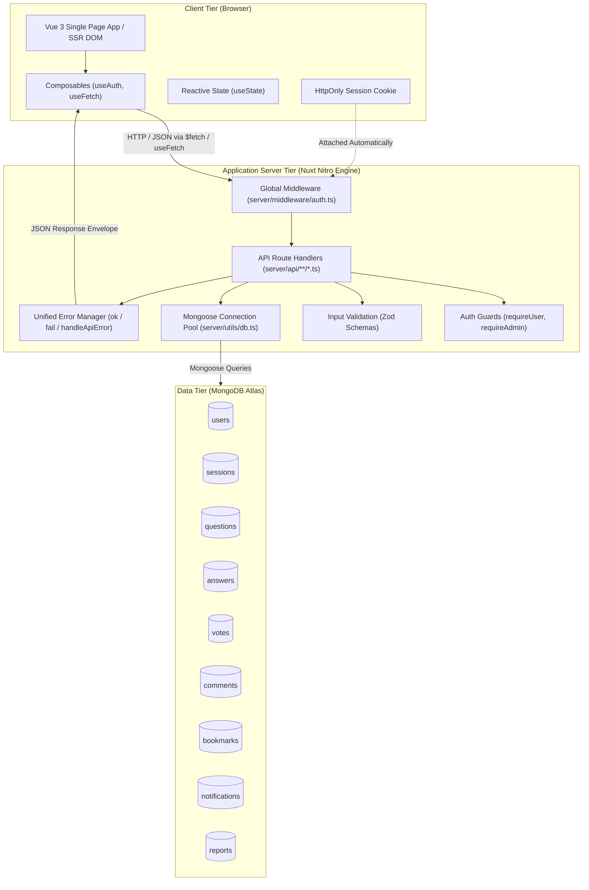
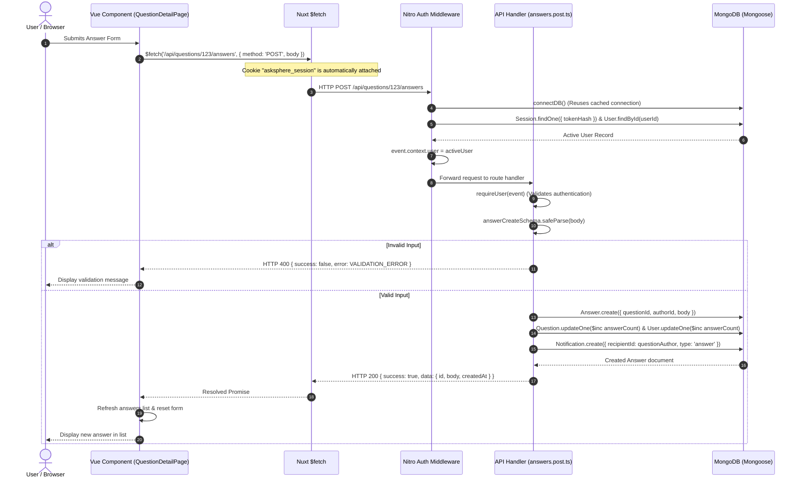
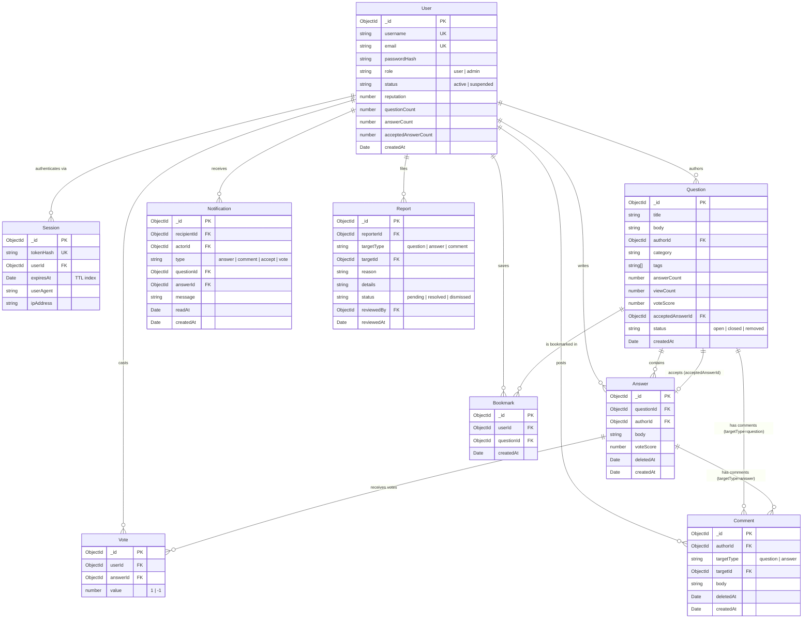

# AskSphere Architecture Documentation

This document provides a comprehensive architectural overview of **AskSphere**, a modern community Question & Answer (Q&A) web application. It outlines the end-to-end technology stack, the API communication pipeline between the frontend and the backend, and the MongoDB database architecture.

---

## Table of Contents

1. [High-Level System Overview](#1-high-level-system-overview)
2. [Technology Stack](#2-technology-stack)
   - [Frontend Architecture](#frontend-architecture)
   - [Backend & Server Architecture](#backend--server-architecture)
   - [Database & Storage](#database--storage)
   - [Developer Tooling & Testing](#developer-tooling--testing)
3. [End-to-End API Flow (Frontend to Backend to Database)](#3-end-to-end-api-flow-frontend-to-backend-to-database)
   - [Step-by-Step Lifecycle](#step-by-step-lifecycle)
   - [Visual Sequence Diagram](#visual-sequence-diagram)
   - [Frontend Data Fetching Patterns](#frontend-data-fetching-patterns)
   - [Server Middleware & Authentication Pipeline](#server-middleware--authentication-pipeline)
   - [Validation & Error Handling Convention](#validation--error-handling-convention)
4. [API Surface & Route Mapping](#4-api-surface--route-mapping)
5. [Database Architecture & Data Models](#5-database-architecture--data-models)
   - [Database Connection & Pooling](#database-connection--pooling)
   - [Entity-Relationship Diagram (ERD)](#entity-relationship-diagram-erd)
   - [Data Models Specification](#data-models-specification)
   - [Database Indexing & Performance Strategy](#database-indexing--performance-strategy)
6. [Security & Session Management](#6-security--session-management)
7. [Repository File & Directory Structure](#7-repository-file--directory-structure)

---

## 1. High-Level System Overview

AskSphere is architected as a **full-stack monorepo application** powered by **Nuxt 4**. It runs both the presentation layer (Vue 3 SSR/SPA) and the API server layer (Nitro engine) within a single unified project structure.



---

## 2. Technology Stack

### Frontend Architecture
* **Framework:** [Nuxt 4](file:///d:/asksphere/nuxt.config.ts) utilizing [Vue 3](file:///d:/asksphere/package.json) with TypeScript and the Composition API (`<script setup>` syntax).
* **Styling & Design System:** [Tailwind CSS 3](file:///d:/asksphere/tailwind.config.ts) integrated via `@nuxtjs/tailwindcss`. Custom CSS utility components and semantic design tokens are declared in [main.css](file:///d:/asksphere/app/assets/css/main.css).
* **Icons:** [lucide-vue-next](file:///d:/asksphere/package.json) (lucide icons for Vue).
* **State Management:** Nuxt's native SSR-friendly reactive state primitive `useState` (e.g., [`useAuth.ts`](file:///d:/asksphere/app/composables/useAuth.ts)).
* **Client Plugins:** Client-side initialization plugins such as [auth-init.client.ts](file:///d:/asksphere/app/plugins/auth-init.client.ts) to verify authenticated sessions on initial browser load.

### Backend & Server Architecture
* **Server Engine:** **Nitro** (the lightweight, high-performance engine built into Nuxt 4, running on top of the **H3** minimal HTTP framework).
* **Routing Paradigm:** File-system based server routing under `server/api/` with HTTP method suffixes (e.g., `.get.ts`, `.post.ts`, `.patch.ts`, `.delete.ts`) and dynamic parameters (`[id]`, `[username]`).
* **Validation:** [Zod](file:///d:/asksphere/server/utils/validation.ts) for strict schema parsing and sanitization of request bodies, query strings, and URL route parameters.
* **Authentication & Cryptography:** 
  * Password hashing via [bcryptjs](file:///d:/asksphere/package.json) ([password.ts](file:///d:/asksphere/server/utils/password.ts)).
  * High-entropy random token generation and cryptographic SHA-256 token hashing via Node.js native `crypto` module ([session.ts](file:///d:/asksphere/server/utils/session.ts)).
* **Rate Limiting:** Token-bucket based in-memory rate limiter for abuse prevention ([rateLimit.ts](file:///d:/asksphere/server/utils/rateLimit.ts)).

### Database & Storage
* **Database:** **MongoDB** (compatible with local instances and MongoDB Atlas).
* **Object Data Modeling (ODM):** [Mongoose 8](file:///d:/asksphere/package.json) with strict TypeScript types, schema indexes, cascade updates, and lean query projections.
* **Connection Management:** Cached singleton connection with lazy reconnection and timeout handling ([db.ts](file:///d:/asksphere/server/utils/db.ts)).

### Developer Tooling & Testing
* **Language & Compiler:** TypeScript 5 in strict mode.
* **Testing:** [Vitest](file:///d:/asksphere/vitest.config.ts) for unit tests covering password security, rate limiting, and validation schemas ([tests/unit](file:///d:/asksphere/tests/unit)).
* **Scripts & Seeding:** [tsx](file:///d:/asksphere/server/scripts/seed.ts) for executing database seeding scripts directly with TypeScript support.

---

## 3. End-to-End API Flow (Frontend to Backend to Database)

### Step-by-Step Lifecycle

The communication between the frontend client and the database executes through an explicit, 8-stage pipeline:

```
[1. User Trigger] 
       │
       ▼
[2. Vue Client Request] ── (useFetch / $fetch with credentials)
       │
       ▼
[3. Nitro Global Middleware] ── (server/middleware/auth.ts)
       │  • connectDB()
       │  • Reads 'asksphere_session' cookie
       │  • Hashes token & verifies in Mongo sessions collection
       │  • Populates event.context.user
       │
       ▼
[4. Server API Handler] ── (e.g. server/api/questions/[id]/answers.post.ts)
       │  • Checks route parameters (e.g. valid ObjectId)
       │  • Checks authorization guards (requireUser / requireAdmin)
       │
       ▼
[5. Request Body Validation] ── (Zod safeParse in server/utils/validation.ts)
       │  • Returns 400 VALIDATION_ERROR on malformed input
       │
       ▼
[6. Database Execution] ── (Mongoose models: Question, Answer, User, Notification)
       │  • Query/Mutation execution (atomic updates, $inc counters)
       │
       ▼
[7. Unified Envelope Response] ── (ok(data) / fail(code, message))
       │  • { success: true, data: { ... } }
       │
       ▼
[8. Vue State Hydration] ── (Component reactivity, cache refresh, router navigation)
```

---

### Visual Sequence Diagram

The following sequence diagram details a standard authenticated request—specifically, submitting an answer to a question:



---

### Frontend Data Fetching Patterns

The client uses two primary data-fetching primitives provided by Nuxt:

1. **`useFetch` (Declarative & SSR-safe):**
   * Used in page components (e.g. [`questions/index.vue`](file:///d:/asksphere/app/pages/questions/index.vue) and [`questions/[id].vue`](file:///d:/asksphere/app/pages/questions/[id].vue)).
   * Executes on the server during Server-Side Rendering (SSR) to populate HTML before sending to the client, preventing content flash.
   * On client navigation, it fetches asynchronously and provides reactive `data`, `pending`, `error`, and `refresh` handles.

   ```ts
   // Example from app/pages/questions/[id].vue
   const { data, pending, error } = await useFetch<{
     success: boolean
     data: QuestionDetail
   }>(`/api/questions/${id}`)
   ```

2. **`$fetch` (Imperative & Event-Driven):**
   * Used for user actions and mutations: button clicks, form submissions, deletions, and bookmark toggling.
   * Example: [`toggleBookmark`](file:///d:/asksphere/app/pages/questions/[id].vue#L249-L264), [`login`](file:///d:/asksphere/app/composables/useAuth.ts#L39-L46), or [`createNotification`](file:///d:/asksphere/server/utils/notifications.ts).

   ```ts
   // Example from app/pages/questions/[id].vue
   await $fetch(`/api/questions/${id}/comments`, {
     method: 'POST',
     body: { body: commentText }
   })
   await refreshQuestionComments()
   ```

---

### Server Middleware & Authentication Pipeline

Every inbound API request passes through the Nitro server middleware in [server/middleware/auth.ts](file:///d:/asksphere/server/middleware/auth.ts):

1. **Path Filter:** Only triggers for routes starting with `/api/` (ignoring static assets).
2. **Database Verification:** Invokes `connectDB()` to guarantee an active MongoDB connection.
3. **Session Resolution:** Reads `asksphere_session` cookie via `getSessionUser(event)`:
   * Hashes the raw session cookie with SHA-256.
   * Queries the `sessions` collection for `tokenHash`.
   * Checks expiration (`expiresAt < Date.now()`).
   * Loads the user record from the `users` collection and assigns it to `event.context.user`.
4. **Guards in Handlers:**
   * [`requireUser(event)`](file:///d:/asksphere/server/utils/auth.ts#L11-L17): Throws `401 UNAUTHENTICATED` if `event.context.user` is null.
   * [`requireAdmin(event)`](file:///d:/asksphere/server/utils/auth.ts#L22-L28): Throws `403 FORBIDDEN` if the user's role is not `admin`.

---

### Validation & Error Handling Convention

All API endpoints follow a unified response structure defined in [server/utils/errors.ts](file:///d:/asksphere/server/utils/errors.ts):

#### Success Response Envelope (`ok<T>`)
```json
{
  "success": true,
  "data": {
    "id": "67104b281f4a9b5f9036c1e2",
    "title": "How do index scans work in MongoDB?",
    "category": "Technology"
  }
}
```

#### Failure Response Envelope (`fail()`)
```json
{
  "success": false,
  "error": {
    "code": "VALIDATION_ERROR",
    "message": "Please check your input.",
    "details": {
      "fieldErrors": {
        "title": ["String must contain at least 10 character(s)"]
      }
    }
  }
}
```

---

## 4. API Surface & Route Mapping

The table below catalogs the API surface exposed by the Nitro server engine under `server/api/`:

| Route Path | Method | Auth Required | Description |
| :--- | :--- | :---: | :--- |
| **Auth** | | | |
| `/api/auth/register` | `POST` | No | Creates a user account, hashes password, generates session cookie |
| `/api/auth/login` | `POST` | No | Validates credentials, sets session cookie |
| `/api/auth/logout` | `POST` | Yes | Destroys server session record and clears browser cookie |
| `/api/auth/me` | `GET` | No | Returns the currently authenticated user or `null` |
| **Questions** | | | |
| `/api/questions` | `GET` | No | Lists questions with pagination, search, sorting, tag, and category filters |
| `/api/questions` | `POST` | Yes | Creates a new question |
| `/api/questions/:id` | `GET` | No | Retrieves question details and increments view count |
| `/api/questions/:id` | `PATCH` | Author/Admin | Updates title, body, category, or tags |
| `/api/questions/:id` | `DELETE` | Author/Admin | Marks question status as `removed` |
| `/api/questions/:id/accept-answer` | `POST` | Author | Marks an answer as accepted and awards reputation |
| `/api/questions/:id/answers` | `GET` | No | Retrieves answers for a question |
| `/api/questions/:id/answers` | `POST` | Yes | Submits a new answer and sends a notification |
| `/api/questions/:id/answers-with-comments` | `GET` | No | Fetches answers along with threaded comments |
| `/api/questions/:id/bookmark` | `PUT` | Yes | Adds a question to the user's bookmarks |
| `/api/questions/:id/bookmark` | `DELETE` | Yes | Removes question from bookmarks |
| `/api/questions/:id/comments` | `GET` | No | Retrieves comments attached to a question |
| `/api/questions/:id/comments` | `POST` | Yes | Posts a comment on a question |
| **Answers** | | | |
| `/api/answers/:id` | `PATCH` | Author/Admin | Edits answer body |
| `/api/answers/:id` | `DELETE` | Author/Admin | Soft-deletes answer |
| `/api/answers/:id/vote` | `PUT` | Yes | Casts an upvote (`1`) or downvote (`-1`) |
| `/api/answers/:id/vote` | `DELETE` | Yes | Cancels an existing vote |
| `/api/answers/:id/comments` | `GET` | No | Retrieves comments attached to an answer |
| `/api/answers/:id/comments` | `POST` | Yes | Posts a comment on an answer |
| **Comments** | | | |
| `/api/comments/:id` | `PATCH` | Author/Admin | Updates comment content |
| `/api/comments/:id` | `DELETE` | Author/Admin | Soft-deletes comment |
| **User & Social** | | | |
| `/api/users/:username` | `GET` | No | Fetches public user profile and activity stats |
| `/api/users/me` | `PATCH` | Yes | Updates profile bio and avatar |
| `/api/bookmarks` | `GET` | Yes | Retrieves list of questions saved by current user |
| `/api/notifications/read-all` | `POST` | Yes | Marks all notifications as read |
| `/api/notifications/:id/read` | `PATCH` | Yes | Marks single notification as read |
| `/api/leaderboard` | `GET` | No | Top users ranked by reputation score |
| `/api/categories` | `GET` | No | Predefined category list with question counts |
| `/api/tags` | `GET` | No | Popular tags aggregated across questions |
| `/api/reports` | `POST` | Yes | Flags content for moderator review |
| **Admin** | | | |
| `/api/admin/stats` | `GET` | Admin | Overview statistics (users, questions, reports) |
| `/api/admin/reports` | `GET` | Admin | Fetches pending moderation reports |
| `/api/admin/reports/:id` | `PATCH` | Admin | Resolves or dismisses a report |
| `/api/admin/users` | `GET` | Admin | Lists users with status filtering |
| `/api/admin/users/:id` | `PATCH` | Admin | Suspends, activates, or changes user roles |

---

## 5. Database Architecture & Data Models

### Database Connection & Pooling

Database connectivity is managed through [server/utils/db.ts](file:///d:/asksphere/server/utils/db.ts). It enforces a **cached singleton connection**:
* Avoids exhausting connection pools across serverless invocations or local hot module reloads.
* Configures `serverSelectionTimeoutMS: 10000` to prevent request hangs during connection issues.
* Environment variable `MONGODB_URI` provides the target connection string.

---

### Entity-Relationship Diagram (ERD)

The relations between the 9 MongoDB collections managed by Mongoose are modeled as follows:



---

### Data Models Specification

#### 1. User Model ([`User.ts`](file:///d:/asksphere/server/models/User.ts))
* Stores user credentials, profile information, and aggregated reputation metrics.
* `passwordHash` is configured with `select: false` so it is excluded from queries by default.
* Tracks counter caches (`questionCount`, `answerCount`, `acceptedAnswerCount`) to enable instantaneous profile displays without aggregate queries.

#### 2. Session Model ([`Session.ts`](file:///d:/asksphere/server/models/Session.ts))
* Stores server-side sessions. The cookie value is hashed using SHA-256 before storage (`tokenHash`).
* Configured with a MongoDB **TTL Index** on `expiresAt` (`{ expireAfterSeconds: 0 }`), enabling MongoDB to automatically prune expired sessions.

#### 3. Question Model ([`Question.ts`](file:///d:/asksphere/server/models/Question.ts))
* Represents the primary discussion subject.
* Categories are strictly checked against an allowed list: `Technology`, `Programming`, `Science`, `Mathematics`, `Education`, `Career`, `Business`, `Health and Wellness`, `Lifestyle`, `General Knowledge`, `Other`.
* Includes up to 5 normalized lowercase tags.
* Indexed for full-text search across `title` (weight 5) and `body` (weight 1).

#### 4. Answer Model ([`Answer.ts`](file:///d:/asksphere/server/models/Answer.ts))
* Relates to a parent `questionId` and an `authorId`.
* Implements soft deletion (`deletedAt: Date`) to preserve discussion structure and reply context.
* Tracks `voteScore` incrementally.

#### 5. Vote Model ([`Vote.ts`](file:///d:/asksphere/server/models/Vote.ts))
* Represents an upvote (`+1`) or downvote (`-1`) on an answer.
* Enforces a compound unique index: `{ userId: 1, answerId: 1 }` to guarantee that a user cannot vote more than once per answer.

#### 6. Comment Model ([`Comment.ts`](file:///d:/asksphere/server/models/Comment.ts))
* Implements a **polymorphic reference pattern**:
  * `targetType`: `'question' | 'answer'`
  * `targetId`: `ObjectId` pointing to either the question or answer document.
* Indexed by `{ targetType: 1, targetId: 1, createdAt: 1 }`.

#### 7. Bookmark Model ([`Bookmark.ts`](file:///d:/asksphere/server/models/Bookmark.ts))
* Tracks saved questions per user.
* Enforces `{ userId: 1, questionId: 1 }` as a compound unique index to prevent duplicate saves.

#### 8. Notification Model ([`Notification.ts`](file:///d:/asksphere/server/models/Notification.ts))
* Notifies users when another member interacts with their questions or answers.
* Utility logic ensures a user is never notified of their own actions.

#### 9. Report Model ([`Report.ts`](file:///d:/asksphere/server/models/Report.ts))
* Flags content for spam, abuse, off-topic, or duplicate rule violations.
* Tracks moderation lifecycle: `pending` -> `resolved` | `dismissed`.

---

### Database Indexing & Performance Strategy

To ensure sub-millisecond query performance under load, the following Mongoose indexes are established:

| Collection | Indexed Fields | Type | Purpose |
| :--- | :--- | :---: | :--- |
| **users** | `{ username: 1 }`, `{ email: 1 }` | Unique | Login lookup & uniqueness check |
| **sessions** | `{ tokenHash: 1 }` | Unique | Session authorization |
| **sessions** | `{ expiresAt: 1 }` | TTL (0s) | Automatic MongoDB session eviction |
| **questions** | `{ title: "text", body: "text" }` | Text | Keyword search (`/api/questions?search=...`) |
| **questions** | `{ createdAt: -1 }` | Secondary | "Latest" feed sorting |
| **questions** | `{ voteScore: -1, answerCount: -1 }` | Compound | "Popular" feed sorting |
| **questions** | `{ category: 1, createdAt: -1 }` | Compound | Filter by category |
| **questions** | `{ tags: 1 }` | Multikey | Filter by tag |
| **answers** | `{ questionId: 1, voteScore: -1 }` | Compound | Ordering answers by score per question |
| **answers** | `{ questionId: 1, createdAt: 1 }` | Compound | Chronological answer fallback |
| **votes** | `{ userId: 1, answerId: 1 }` | Compound Unique | Prevents duplicate voting |
| **bookmarks**| `{ userId: 1, questionId: 1 }` | Compound Unique | Prevents duplicate bookmarks |
| **comments** | `{ targetType: 1, targetId: 1, createdAt: 1 }` | Compound | Polymorphic comment retrieval |
| **notifications** | `{ recipientId: 1, readAt: 1, createdAt: -1 }` | Compound | Unread notifications tray |
| **reports** | `{ status: 1, createdAt: -1 }` | Compound | Moderator queue triage |

---

## 6. Security & Session Management

```
┌────────────────────────────────────────────────────────────────────────┐
│                        Cookie-Based Session Flow                       │
└────────────────────────────────────────────────────────────────────────┘

  [Browser]                                    [Nitro Server]
     │                                               │
     │ 1. POST /api/auth/login                       │
     │──────────────────────────────────────────────>│
     │                                               │ 2. Verify password with bcrypt
     │                                               │ 3. Generate 48-byte token
     │                                               │ 4. Compute SHA-256(token)
     │                                               │ 5. Store hash in MongoDB 'sessions'
     │ 6. Set-Cookie: asksphere_session=<raw-token>  │
     │    (HttpOnly, Secure, SameSite=Lax, 30 days)  │
     │<──────────────────────────────────────────────│
     │                                               │
     │ 7. Subsequent Requests (Automatic Cookie)     │
     │──────────────────────────────────────────────>│
     │                                               │ 8. Hash incoming token
     │                                               │ 9. Find session in DB by hash
     │                                               │ 10. Attach User to event.context
```

* **Protection Against Database Leaks:** The session token is stored in the database **hashed with SHA-256**. If the database is compromised, existing tokens cannot be used by attackers to hijack sessions.
* **XSS Defense:** The cookie is set with `httpOnly: true`, preventing client-side JavaScript from accessing it.
* **CSRF Mitigation:** The cookie uses `sameSite: 'lax'`, preventing cross-site state-changing request forgery.
* **Transport Security:** The cookie enforces `secure: true` when running in production (`NODE_ENV === 'production'`).
* **Input Sanitization:** Handled transparently by Zod schemas and Mongoose type casting to prevent injection vulnerabilities.

---

## 7. Repository File & Directory Structure

```
asksphere/
├── app/                              # Frontend (Vue 3 / Nuxt 4 Presentation Tier)
│   ├── app.vue                       # Root layout wrapper
│   ├── assets/css/main.css           # Tailwind layers, tokens & component classes
│   ├── components/                   # Reusable UI components
│   │   ├── AnswerCard.vue            # Answer display & vote binding
│   │   ├── AnswerForm.vue            # Markdown/text answer creation
│   │   ├── BookmarkButton.vue        # Save question toggle
│   │   ├── CommentList.vue           # Threaded comment view
│   │   ├── QuestionCard.vue          # Feed item for questions
│   │   └── VoteButtons.vue           # Up/down vote UI
│   ├── composables/                  # State & business logic composables
│   │   └── useAuth.ts                # Auth state (user, login, register, logout)
│   ├── layouts/                      # Layout wrappers (default, admin)
│   ├── middleware/                   # Client route guards (e.g. admin.ts)
│   ├── pages/                        # File-based application routes
│   │   ├── index.vue                 # Homepage feed
│   │   ├── ask.vue                   # Question submission page
│   │   ├── questions/                # Question browsing & detail views
│   │   │   ├── index.vue             # Filterable list of questions
│   │   │   └── [id].vue              # Question detail with answers & comments
│   │   ├── admin/                    # Admin moderation dashboard
│   │   └── users/[username].vue      # User profile view
│   └── plugins/                      # Client-side initialization plugins
│       └── auth-init.client.ts       # Hydrates session on initial page load
│
├── server/                           # Backend (Nitro Server Engine)
│   ├── api/                          # File-based HTTP API routes
│   │   ├── admin/                    # Admin statistics & moderation endpoints
│   │   ├── answers/                  # Answer CRUD, votes, and comments
│   │   ├── auth/                     # Login, register, logout, me endpoints
│   │   ├── bookmarks/                # Bookmark index endpoint
│   │   ├── categories/               # Category taxonomy endpoint
│   │   ├── comments/                 # Comment CRUD endpoints
│   │   ├── leaderboard/              # Reputation leaderboard endpoint
│   │   ├── notifications/            # User notification management
│   │   ├── questions/                # Question CRUD & sub-resource endpoints
│   │   ├── reports/                  # Report creation endpoint
│   │   ├── tags/                     # Tag aggregation endpoint
│   │   └── users/                    # Profile management endpoints
│   ├── middleware/                   # Server-side request middleware
│   │   └── auth.ts                   # Attaches session user to event.context
│   ├── models/                       # Mongoose schemas & TypeScript types
│   │   ├── Answer.ts                 # Answer model
│   │   ├── Bookmark.ts               # Bookmark model
│   │   ├── Comment.ts                # Polymorphic comment model
│   │   ├── Notification.ts           # Notification model
│   │   ├── Question.ts               # Question model
│   │   ├── Report.ts                 # Moderation report model
│   │   ├── Session.ts                # Hashed session model
│   │   ├── User.ts                   # User profile & credentials model
│   │   └── Vote.ts                   # Vote model
│   ├── scripts/                      # Standalone CLI tools & seeding
│   │   └── seed.ts                   # Database seeder with sample data
│   └── utils/                        # Server utility functions & helpers
│       ├── auth.ts                   # requireUser & requireAdmin guards
│       ├── db.ts                     # Cached Mongoose connection
│       ├── errors.ts                 # ok, fail, handleApiError envelopes
│       ├── notifications.ts          # Notification generator helper
│       ├── password.ts               # bcrypt hash & verify functions
│       ├── rateLimit.ts              # In-memory sliding rate limiter
│       ├── session.ts                # Cookie & session creation/verification
│       └── validation.ts             # Zod input validation schemas
│
├── tests/                            # Automated test suites
│   └── unit/                         # Vitest unit tests
│       ├── password.test.ts
│       ├── rateLimit.test.ts
│       └── validation.test.ts
│
├── nuxt.config.ts                    # Main Nuxt 4 configuration
├── tailwind.config.ts                # Tailwind design theme configuration
├── package.json                      # Project dependencies & scripts
├── vitest.config.ts                  # Test runner configuration
└── ARCHITECTURE.md                   # This architecture document
```
